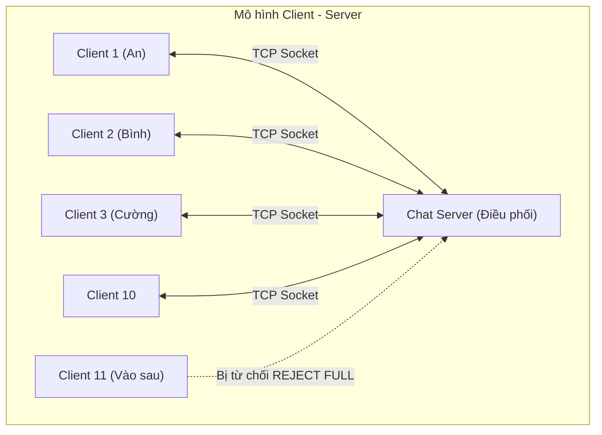
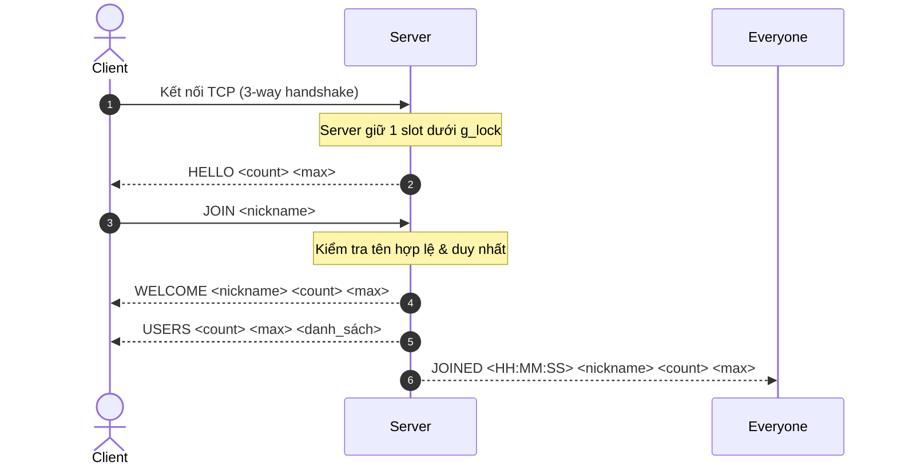
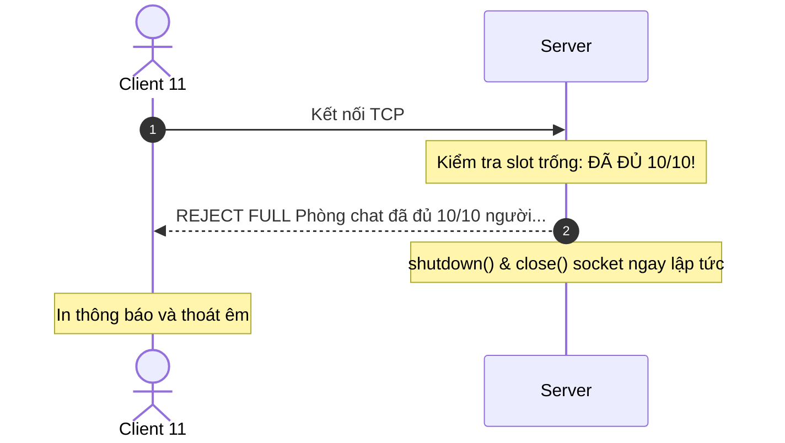

# ỨNG DỤNG CHAT NHIỀU NGƯỜI DÙNG BẰNG TCP/IP (NGÔN NGỮ C TRÊN LINUX)

Hệ thống Chat Application phục vụ đồ án môn **Lập trình mạng** (Giảng viên: **Thầy Văn Võ**).  
Chương trình được viết hoàn toàn bằng **C thuần (chuẩn C11)**, sử dụng **POSIX Socket**, **POSIX Threads (`pthread`)**, kiến trúc Client - Server với cơ chế quản lý tối đa 10 người dùng đồng thời.

---

## 1. Sơ đồ kiến trúc & Trình tự hoạt động (Mermaid)

### Kiến trúc hình sao (Star Topology)


### Trình tự kết nối và Bắt tay (Handshake)


### Trình tự từ chối khi phòng đầy (Người thứ 11)


---

## 2. Yêu cầu môi trường & Cài đặt

Chạy trên môi trường Linux (Ubuntu 22.04 / 24.04 / 25.04). Cài đặt các công cụ cần thiết:
```bash
sudo apt update
sudo apt install -y build-essential gcc make gdb valgrind tmux netcat-openbsd cppcheck
```

---

## 3. Hướng dẫn biên dịch & Kiểm thử

Dự án đi kèm `Makefile` chuẩn hoá:

```bash
# Biên dịch cả Server và Client (chế độ -O2, -Wall -Wextra -Werror)
make all

# Chạy toàn bộ bộ kiểm thử tự động (Unit test, Integration test, Smoke test)
make test

# Chạy bộ kiểm thử với AddressSanitizer + UndefinedBehaviorSanitizer
make asan

# Chạy bộ kiểm thử với ThreadSanitizer (phát hiện data race)
make tsan

# Kiểm tra rò rỉ bộ nhớ & File Descriptor (kể cả server + itest) với Valgrind
make valgrind

# Kiểm tra tĩnh toàn bộ mã nguồn bằng cppcheck
make cppcheck

# Dọn dẹp các file sinh ra
make clean
```

---

## 4. Hướng dẫn chạy chương trình

### Khởi động Server
```bash
# Cú pháp: ./build/server [-p PORT] [-m MAX_CLIENTS] [-v]
./build/server -p 5555 -m 10 -v
```
Server sẽ in ra địa chỉ IP của các card mạng đang có để các máy khác trong mạng kết nối.

### Khởi động Client
```bash
# Cú pháp: ./build/client [IP_SERVER] [PORT] [NICKNAME] [--no-color]
./build/client 127.0.0.1 5555 An
```
Nếu không điền tham số, chương trình sẽ hỏi tương tác qua bàn phím.

### Các lệnh hỗ trợ ngay trong phiên Chat
- `/help`: Xem hướng dẫn sử dụng các lệnh.
- `/users` (hoặc `/list`): Xem danh sách người dùng đang online (`n/10`).
- `/threads` (hoặc `/info`): Xem chi tiết `Server PID (TGID)` và danh sách các luồng `Worker TID (LWP)` đang phục vụ từng Client trên nhân Linux (rất hữu ích khi demo vấn đáp với giảng viên).
- `/w <tên> <tin_nhắn>` (hoặc `/msg <tên> <tin_nhắn>`): Gửi tin nhắn riêng (Whisper / Private Message).
- `/quit` (hoặc `/exit`): Thoát khỏi phòng chat lịch sự.

### Demo 10 Client đồng thời bằng tmux
```bash
bash scripts/run_10_clients.sh 127.0.0.1 5555
```

---

## 5. Hướng dẫn demo mạng LAN với máy ảo VirtualBox

### Cách 1: Sử dụng Bridged Adapter (Khuyên dùng khi demo trên lớp)
1. Trong cửa sổ chính của VirtualBox, tắt máy ảo Ubuntu.
2. Vào **Settings** -> **Network** -> **Adapter 1**.
3. Chọn **Attached to: Bridged Adapter**, chọn card mạng Wi-Fi của laptop.
4. Bật máy ảo, mở Terminal gõ `ip -4 addr show` để lấy IP dạng `192.168.x.x`.
5. Các bạn khác trong lớp cùng kết nối Wi-Fi có thể chạy client trỏ trực tiếp tới IP này:
   ```bash
   ./build/client 192.168.x.x 5555
   ```

### Cách 2: Sử dụng NAT kèm Port Forwarding (Khi chạy trên 1 máy tính)
Mở PowerShell trên Windows và gõ lệnh chuyển tiếp cổng:
```powershell
& "C:\Program Files\Oracle\VirtualBox\VBoxManage.exe" modifyvm "Linux" --natpf1 "chat,tcp,,5555,,5555"
```
Khi đó, các ứng dụng trên Windows (như PuTTY ở chế độ Raw) có thể kết nối tới `127.0.0.1:5555` để trò chuyện cùng client trong máy ảo.
